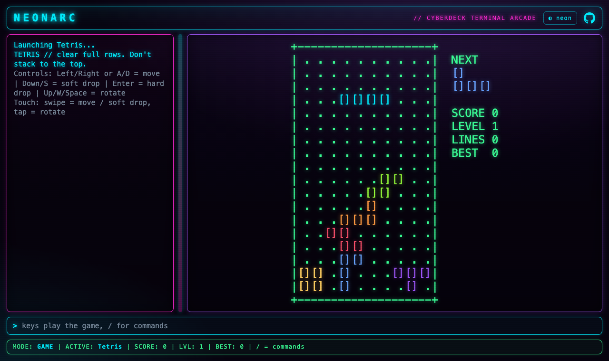
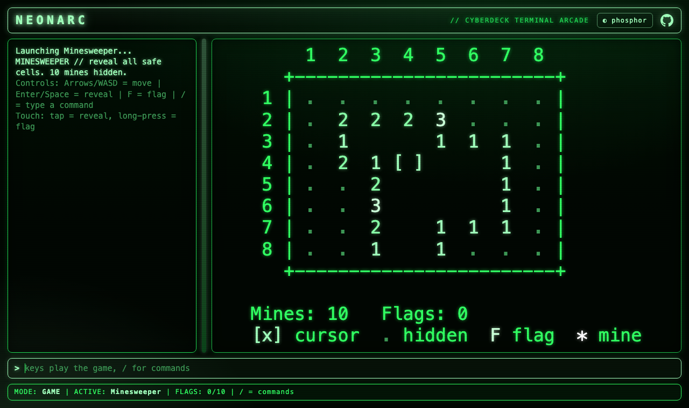
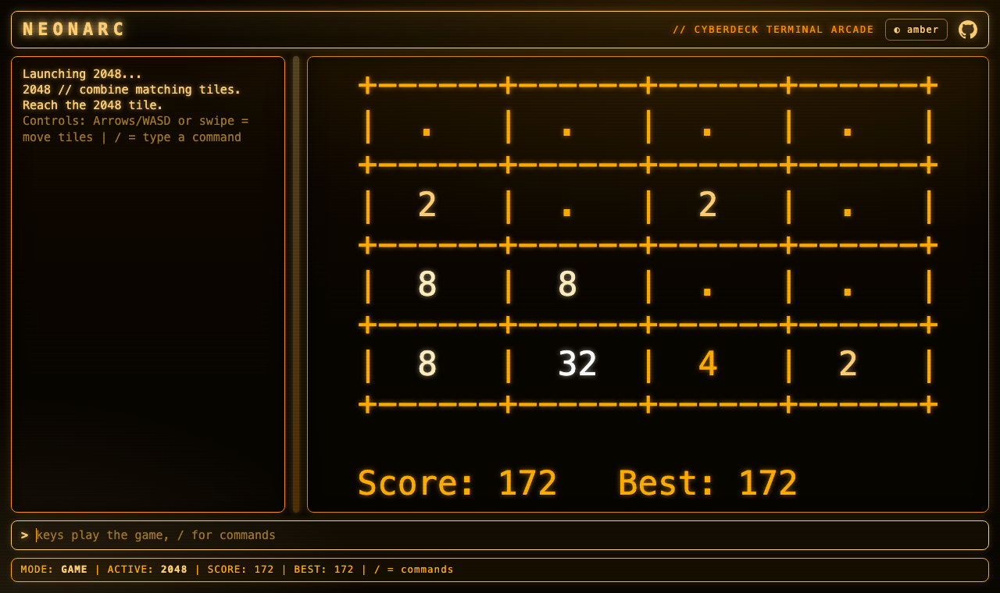
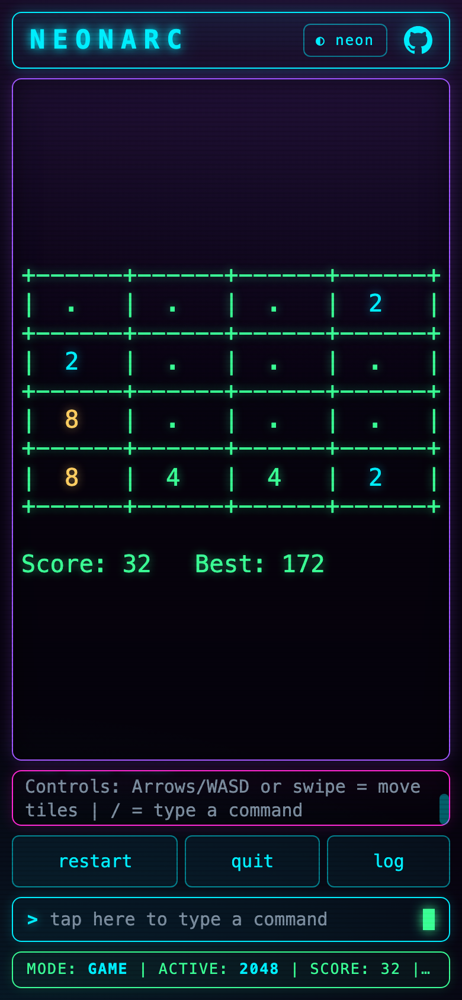

# NeonArc

[](https://github.com/atahan99/NeonArc/actions/workflows/ci.yml)

A terminal-style arcade that runs in the browser: eight small games and five
retro Unix toys (`cmatrix`, `cowsay`, `pipes`, `lolcat`, `sl`), driven by a
command prompt. Every board is plain monospace text. There is no canvas, no
image, no framework and no runtime dependency.

**[Play it at neonarc.cybrsmr.xyz](https://neonarc.cybrsmr.xyz)**, or jump
straight into a game: [/#tetris](https://neonarc.cybrsmr.xyz/#tetris),
[/#2048](https://neonarc.cybrsmr.xyz/#2048),
[/#minesweeper](https://neonarc.cybrsmr.xyz/#minesweeper).



| Phosphor theme | Amber theme | Phone |
|---|---|---|
|  |  |  |

## Why it exists

I wanted to see how far plain DOM text could go as a game renderer. Each frame
is a string: the board is built as text, coloured cells are wrapped in
`<span>`s, and the result is written to one `<pre>`. The font size is fitted
to the board, so the same text grid fills a desktop window or a phone.

## What's inside

| # | Name | Type | Notes |
|---|------|------|-------|
| 1 | Snake | real-time | 24x15 board, buffered turns, best score saved |
| 2 | Tetris | real-time | 7-bag, next-piece preview, lock delay, wall kicks, speeds up every 10 lines |
| 3 | Sudoku | puzzle | a fresh variant of the puzzle each game, live duplicate highlighting |
| 4 | Tower of Hanoi | puzzle | 3 to 7 disks (`restart 5`), moves typed as `1 3` |
| 5 | Minesweeper | puzzle | 8x8, 10 mines, the first click always opens an area |
| 6 | 2048 | puzzle | best score saved |
| 7 | Hangman | word | 50 words, 6 misses |
| 8 | Tic-Tac-Toe | two-player | hot-seat, the starter alternates, running score |
| 9 | cmatrix | toy | falling code rain |
| 10 | cowsay | toy | type a line and the cow says it |
| 11 | pipes | toy | the pipes screensaver |
| 12 | lolcat | toy | animated rainbow text |
| 13 | sl | toy | a steam locomotive crosses the screen |

## Using it

Type a number, a name or a command at the `>` prompt.

```
help            list commands
list            games and tools with descriptions
play <name>     launch by name, e.g. play tetris
restart [n]     restart the current game (Hanoi takes a disk count)
quit, menu      back to the menu
theme [name]    neon, phosphor or amber (or click the theme button)
clear           clear the terminal log
about           about NeonArc
```

Names have aliases (`mines`, `ttt`, `matrix`, `cow`, `train` and a few more),
menu entries are clickable, Up/Down walk the command history and Tab completes.

**Keys and commands.** In Snake, Tetris, Sudoku, Minesweeper, 2048 and
Tic-Tac-Toe the keyboard plays the game. Press `/` to type a command, then
Enter to run it or Esc to go back. The game pauses while you type. A letter
the game doesn't use (the `q` of `quit`, the `r` of `restart`) opens the
prompt by itself. Hangman, Hanoi, cowsay and lolcat are played by typing, so
their prompt is always open.

**Controls:**

- **Snake, Tetris, 2048:** arrow keys or WASD. In Tetris, Up/W/Space rotates, Down/S soft-drops and Enter hard-drops.
- **Sudoku, Minesweeper, Tic-Tac-Toe:** arrows or WASD move the cursor. Digits fill Sudoku cells or place a Tic-Tac-Toe mark; Enter/Space reveals and F flags in Minesweeper.
- **Touch:** swipe for Snake, 2048 and Tetris (tap or the rotate button rotates, drop hard-drops). Tap a cell in Sudoku (then the digit pad), Minesweeper (long-press flags) and Tic-Tac-Toe. The mouse can click cells too.

## Run it locally

ES modules don't load from `file://`, so serve the `public/` folder:

```bash
git clone https://github.com/atahan99/NeonArc.git
cd NeonArc
python3 -m http.server -d public 8000
```

Then open http://localhost:8000. `npm run dev` runs it with `wrangler dev`
instead, which also applies the production security headers.

Run the tests (Node 20 or newer, nothing to install):

```bash
npm test
```

## How it works

```
public/
  index.html          markup only
  style.css           theme tokens and palette classes
  src/main.js         the shell: commands, input modes, status bar, splitter, themes, boot
  src/term.js         output: log lines, the board, fit-to-viewport, storage, timers
  src/touch.js        swipes, taps and long-presses turned into key presses
  src/games/*.js      one module per game
  src/tools/*.js      one module per toy
test/games.test.js    rules tests (node --test)
```

Every game module exports its pure rules (slide and merge, rotation and
collision, flood fill, conflict checks) for the tests, and a default object
the shell drives:

```js
export default {
  name, description,
  kind,                 // "tool" for the Unix toys
  start(), restart(arg),
  stop(),               // only when a timer must be cleared
  handleKey(event),     // optional: the game owns the keyboard
  handleCommand(text),  // optional: the game is played by typing
  touch,                // optional: { swipe, tap, hold, keys } mapping touches to keys
  cellAt(line, col),    // optional: text position -> board cell, for tap-to-move
  cursorAt(),           // optional: current cursor cell
  statusText()          // optional: live status bar text
};
```

Adding a game means writing one module and adding its name to a list in
`main.js`.

### Decisions

- **Text, not canvas.** Text scales with the font, can be selected and
  copied, and keeps the renderer to string building. The cost is that the
  board is rebuilt each frame. That is cheap at these sizes, and layout is only
  measured when the grid grows, not on every frame.
- **Touch is just more keys.** A game declares a `touch` map, and the shell
  turns swipes, taps and long-presses into the same key events the keyboard
  sends. No game has touch-specific code.
- **Explicit input modes.** An earlier version guessed whether a key was a
  game move or the start of a command. The guess had edge cases (pressing `s`
  then `l` in Snake looked like the `sl` command). A game now owns the keys
  until you press `/`.
- **Themes are tokens.** Board colours are classes like `.hi` and `.warn`,
  never inline styles. A theme swaps the CSS variables behind them, which also
  lets the Content-Security-Policy ban inline styles.
- **Timers that can't leak.** Real-time games and animated toys share a small
  `gameTimer()` wrapper. It is cleared when you leave a game and skips ticks
  while the game is paused.

Best scores (Snake, Tetris, 2048) and the theme are kept in `localStorage`
under `neonarc.*`. Nothing else is stored.

## Security

- No backend, no accounts, no cookies.
- Log output uses `textContent`. Board text goes through one `span()` helper
  that escapes it, so typed text (cowsay, lolcat, Hangman) can't inject HTML.
- The hosted site sends a strict Content-Security-Policy with no
  `'unsafe-inline'` for scripts or styles, plus `X-Frame-Options: DENY`,
  `nosniff`, a strict referrer policy, `Cross-Origin-Opener-Policy` and a
  Permissions-Policy. See [`public/_headers`](public/_headers).
- Only `public/` is deployed. The repo, tests and screenshots are not served.

## Hosting and privacy

The site is static assets on Cloudflare Workers, configured in
[`wrangler.jsonc`](wrangler.jsonc). CI runs the tests on every push and pull
request. It deploys `main` once the repo has the `CLOUDFLARE_API_TOKEN` and
`CLOUDFLARE_ACCOUNT_ID` secrets and the variable `DEPLOY_ENABLED=true`.

On `neonarc.cybrsmr.xyz` the page loads Cloudflare Web Analytics, which is
cookieless and counts page views. A local copy loads nothing from the network.

## Known limitations

- On a phone, Hangman, Hanoi, cowsay and lolcat are played by typing in the prompt (the on-screen keyboard opens); they have no tap controls.
- Screen readers hear the log and score changes, but not the board itself.
- Sudoku variants all come from one hand-picked puzzle, so they share its difficulty.

## License

[MIT](LICENSE) © atahan99
