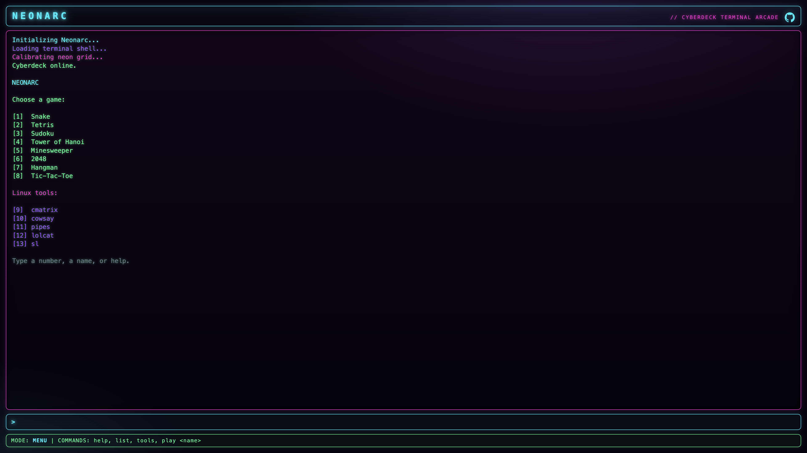

# NeonArc

A terminal-style arcade that runs in the browser. Eight small games and five
retro Unix toys (`cmatrix`, `cowsay`, `pipes`, `lolcat`, `sl`), driven by a
command prompt. Everything lives in one HTML file with no framework, no build
step and no runtime dependencies.

**[Play it at neonarc.cybrsmr.xyz](https://neonarc.cybrsmr.xyz)**



## Why it exists

I wanted to see how far plain DOM text could go as a game renderer. There is no
`<canvas>`, no images and no web fonts: every board is monospace text inside a
`<pre>`, colored with `<span>`s. The single-file rule was a deliberate
constraint. You can save `index.html`, open it from disk and it works.

## What's inside

| # | Name | Type | Notes |
|---|------|------|-------|
| 1 | Snake | real-time | 24x15 board, best score saved |
| 2 | Tetris | real-time | rotation with simple wall kicks, levels speed up every 10 lines |
| 3 | Sudoku | puzzle | one fixed puzzle, live duplicate highlighting |
| 4 | Tower of Hanoi | puzzle | 3 to 7 disks (`restart 5`), moves typed as `1 3` |
| 5 | Minesweeper | puzzle | 8x8, 10 mines, flood fill, first reveal is never a mine |
| 6 | 2048 | puzzle | best score saved |
| 7 | Hangman | word | 20-word list, 6 misses |
| 8 | Tic-Tac-Toe | two-player | hot-seat, running score across rounds |
| 9 | cmatrix | toy | falling code rain |
| 10 | cowsay | toy | type a line and the cow says it |
| 11 | pipes | toy | the pipes screensaver |
| 12 | lolcat | toy | animated rainbow text |
| 13 | sl | toy | a steam locomotive crosses the screen |

## Using it

Type a number, a name or a command at the `>` prompt.

```
help            list commands
list            games and tools with descriptions
tools           tools only
play <name>     launch by name, e.g. play tetris
restart [n]     restart the current game (Hanoi takes a disk count)
quit, menu      back to the menu
clear           clear the terminal log
about           about NeonArc
```

Names have aliases: `mines`, `ttt`, `matrix`, `cow`, `train` and a few more.

Controls are printed when each game starts:

- **Snake, Tetris, 2048:** arrow keys or WASD. In Tetris, Up/W/Space rotates, Down/S soft-drops and Enter hard-drops.
- **Sudoku, Minesweeper, Tic-Tac-Toe:** arrows or WASD move the cursor. Digits fill Sudoku cells or place a Tic-Tac-Toe mark; Enter/Space reveals and F flags in Minesweeper.
- **Touch:** swipe for Snake, 2048 and Tetris (tap or the rotate button rotates, drop hard-drops). Tap a cell in Sudoku (then the digit pad), Minesweeper (long-press flags) and Tic-Tac-Toe. The mouse can click cells too.
- **Hanoi:** type `from to`, e.g. `1 3`.
- **Hangman, cowsay, lolcat:** type text and press Enter.

Menu entries are clickable, Up/Down walk the command history and Tab completes
commands and names. A line that is a command or a launch name/number always
goes to the shell, even mid-game, so `snake` in cowsay launches Snake and
`2048` in Sudoku launches 2048. A game key that could start a command (the `s`
in Snake) still moves the game and stays in the prompt for 0.7 s, so typing on
continues the command.

## Run it locally

```bash
git clone https://github.com/atahan99/NeonArc.git
cd NeonArc
open index.html
```

On Linux use `xdg-open index.html`, or double-click the file. No server is needed.

## How it works

The script is a small shell plus two registries, `GAMES` and `TOOLS`. The shell
owns the boot sequence, the terminal log, command parsing, keyboard routing,
the status bar and the draggable splitter. Each game is a self-contained object
with the same shape:

```js
{
  name, description,
  kind,                 // "tool" for the Unix toys
  start(), restart(arg),
  stop(),               // only when a timer must be cleared
  handleKey(event),     // optional: real-time or cursor input
  handleCommand(text),  // optional: typed input (Hanoi moves, Hangman letters)
  touch,                // optional: { swipe, tap, hold, keys } mapping touches to keys
  cellAt(line, col),    // optional: text position -> board cell, for tap-to-move
  cursorAt(),           // optional: current cursor cell
  statusText()          // optional: live status bar text
}
```

Menu numbers come from the order of `MENU_ORDER` and `TOOL_ORDER`, so adding a
game means writing one object and adding its key to a list.

Rendering is string building: each frame produces the full board as text,
wraps colored cells in `<span>`s and writes it to the `<pre>` in one
assignment. Real-time games and animated toys share a small `setInterval`
wrapper (`gameTimer()`) that is cleared on `stop()`, so leaving a game never
leaves a timer running.

Best scores for Snake, Tetris and 2048 are kept in `localStorage` under
`neonarc.<game>.best`. Nothing else is stored.

### Security notes

- Log output uses `textContent`. The only user text that reaches `innerHTML`
  (cowsay, lolcat, Hangman) is HTML-escaped first.
- The hosted site sends a Content-Security-Policy, `X-Frame-Options: DENY`,
  `nosniff`, a strict referrer policy and a Permissions-Policy that turns off
  sensors, camera, microphone and payments. See [`_headers`](_headers).
- The deploy uses an allowlist, so only `index.html`, `_headers` and the
  favicon are published. The repo, README and screenshots are not served.

## Hosting and privacy

The live site is served as static assets on Cloudflare. The hosted copy loads
Cloudflare Web Analytics, which is cookieless and counts page views. The copy
you open from disk loads nothing from the network.

## Known limitations

- On a phone, Hangman, Hanoi, cowsay and lolcat are played by typing in the prompt (the on-screen keyboard opens); they have no tap controls.
- Two digits typed within 0.7 s in Tic-Tac-Toe or Sudoku (say `1` then `2`) are read as the launch number `12` instead of two moves.
- The game boards are not exposed to screen readers. With `prefers-reduced-motion` on, the CRT flicker, cursor blink and lolcat colour cycling stop, but the animated toys you launch still move.
- Sudoku has a single built-in puzzle.

## License

[MIT](LICENSE) © atahan99
